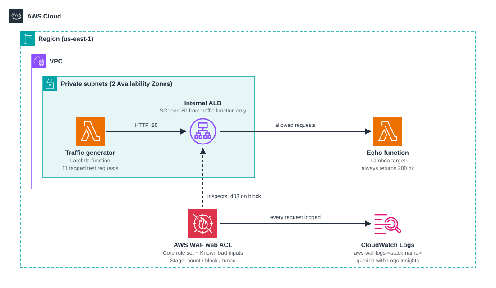

# AWS WAF count-to-block lab

Turn on AWS WAF managed rules without blocking real users. This lab deploys a small test application, puts the AWS managed rules in Count mode, shows you how to find false positives in the WAF logs, and then switches to Block with label-based exceptions instead of disabling rules.

It is the companion to the article **Turn On AWS WAF Without Blocking Real Users: Count Mode, Logs, Tuning, Then Block** on AWS Builder Center.

## What gets deployed



*Diagram drawn with the official [AWS Architecture Icons](https://aws.amazon.com/architecture/icons/). The echo function is an ALB target and does not run in the VPC.*

| Resource | Purpose |
|---|---|
| Internal Application Load Balancer | The protected endpoint. Its security group allows port 80 only from the traffic Lambda. |
| Echo Lambda (target group) | Returns `200 ok` for every request, so any `403` comes from WAF. |
| Traffic Lambda (in your VPC) | Sends 11 test requests: 4 legitimate, 4 attacks, 3 probes. Each carries an `X-Lab-Case` header. |
| WAF web ACL | `AWSManagedRulesCommonRuleSet` and `AWSManagedRulesKnownBadInputsRuleSet`, default action Allow. |
| CloudWatch Logs log group | `aws-waf-logs-<stack-name>`, 7-day retention by default. |

Nothing is exposed to the internet. The ALB is internal, so the lab works in a VPC with no internet gateway. The traffic Lambda only talks to the ALB inside the VPC.

The "attack" requests are harmless test strings (path traversal, Log4Shell, metadata SSRF, reflected XSS) sent only to the lab's own echo function.

## The three stages

The `Stage` parameter controls the web ACL. You move between stages with a stack update.

| Stage | What the web ACL does |
|---|---|
| `count` | Every rule in both managed groups is overridden to Count. Nothing is blocked. Labels are still added, so the logs show what would have been blocked. |
| `block-noisy-count` | The managed rules block, except three Core rule set rules that caused false positives: `NoUserAgent_HEADER`, `SizeRestrictions_BODY` and `CrossSiteScripting_BODY`. Those stay on Count. |
| `tuned` | Same as above, plus three custom rules that block on those rules' labels everywhere except the one path that legitimately needs it. |

The exception rules look like this (priority 2, after both managed groups, because labels only exist after the managed group has run):

```yaml
Statement:
  AndStatement:
    Statements:
      - LabelMatchStatement:
          Scope: LABEL
          Key: awswaf:managed:aws:core-rule-set:CrossSiteScripting_Body
      - NotStatement:
          Statement:
            ByteMatchStatement:
              SearchString: /cms/pages
              FieldToMatch: { UriPath: {} }
              TextTransformations: [{ Priority: 0, Type: NONE }]
              PositionalConstraint: STARTS_WITH
```

Note the label casing: the rule is `CrossSiteScripting_BODY` but the label is `...:CrossSiteScripting_Body`. Copy label keys from your logs, not from the rule names. A wrong key matches nothing and fails silently.

## Prerequisites

- An AWS account you're allowed to test in. Don't deploy this into a production account.
- A VPC with two subnets in different Availability Zones. The default VPC works.
- Permission to create IAM roles, Lambda, ELB, EC2 security groups, WAFv2 and CloudWatch Logs resources through CloudFormation.
- AWS CLI v2 if you want to use the commands below. The console works too.

Tested in `us-east-1`.

## Deploy

Console: CloudFormation > Create stack > Upload a template file > `template.yaml`. Pick your VPC and two subnets, leave `Stage` as `count`, and acknowledge the IAM capability.

CLI:

```bash
STACK=waf-lab
VPC_ID=vpc-xxxxxxxx
SUBNETS=subnet-aaaaaaaa,subnet-bbbbbbbb

aws cloudformation deploy \
  --stack-name "$STACK" \
  --template-file template.yaml \
  --capabilities CAPABILITY_IAM \
  --parameter-overrides VpcId="$VPC_ID" SubnetIds="$SUBNETS" Stage=count
```

Creation takes about 3 to 5 minutes, mostly the ALB.

## Run the lab

### 1. Send traffic in Count mode

```bash
FN=$(aws cloudformation describe-stacks --stack-name "$STACK" \
  --query "Stacks[0].Outputs[?OutputKey=='TrafficFunctionName'].OutputValue" --output text)

aws lambda invoke --function-name "$FN" --payload '{"repeat": 3}' \
  --cli-binary-format raw-in-base64-out out.json && cat out.json
```

Every request returns `200`, including the attacks. That's Count mode working.

### 2. Read the labels

Wait a few minutes for the logs to arrive, then open CloudWatch Logs Insights, pick the `aws-waf-logs-<stack-name>` log group, and run [`queries/01-labels-by-test-case.txt`](queries/01-labels-by-test-case.txt).

You should see the attacks labelled as expected, and three legitimate requests labelled too:

| Test case | Label |
|---|---|
| `legit-upload-12kb` | `core-rule-set:SizeRestrictions_Body` |
| `legit-healthcheck-no-ua` | `core-rule-set:NoUserAgent_Header` |
| `legit-cms-save` | `core-rule-set:CrossSiteScripting_Body` |

Those are the false positives. On real traffic, use [`queries/02-labels-by-uri.txt`](queries/02-labels-by-uri.txt), which groups by label and path and counts distinct client IPs.

Don't rely on the console's sampled requests for this. Count matches from rules inside a managed rule group don't show up in the web ACL's sample, and the sample covers only the last 3 hours.

### 3. Switch to Block, leaving the noisy rules on Count

```bash
aws cloudformation deploy --stack-name "$STACK" --template-file template.yaml \
  --capabilities CAPABILITY_IAM --parameter-overrides Stage=block-noisy-count \
  VpcId="$VPC_ID" SubnetIds="$SUBNETS"
```

Run the traffic function again. Legitimate requests get `200`, attacks get `403`, and the three `negative-*` probes get `200`. The probes send the same content to the wrong paths, which shows the gap: with those rules on Count, nobody is protected from them.

### 4. Add the exceptions

```bash
aws cloudformation deploy --stack-name "$STACK" --template-file template.yaml \
  --capabilities CAPABILITY_IAM --parameter-overrides Stage=tuned \
  VpcId="$VPC_ID" SubnetIds="$SUBNETS"
```

Run the traffic function again. Expected result:

```
legit-home -> 200
legit-upload-12kb -> 200
legit-healthcheck-no-ua -> 200
legit-cms-save -> 200
attack-lfi -> 403
attack-log4j -> 403
attack-ssrf -> 403
attack-xss -> 403
negative-xss-body-comments -> 403
negative-no-ua-admin -> 403
negative-12kb-comments -> 403
```

Confirm which rule blocked each request with [`queries/03-blocked-by-rule.txt`](queries/03-blocked-by-rule.txt). The attacks are terminated by the managed groups, the probes by the three exception rules.

## Cost

US East (N. Virginia) prices checked on 23 November 2026. Estimates, not a bill.

| Item | Price | Lab cost |
|---|---|---|
| Web ACL | $5 per month, prorated hourly | about $0.17 a day |
| Rules and rule groups | $1 each per month, prorated hourly | 2 groups + up to 3 rules, about $0.17 a day |
| WAF requests | $0.60 per million | negligible |
| ALB | $0.0225 per hour plus LCU | about $0.54 a day |
| Lambda, CloudWatch Logs | | within free tier for this volume |

About $1 a day while the stack exists. An hour-long run costs a few cents. Delete the stack when you're done.

For production cost estimates, including WAF log ingestion, see the article.

## Clean up

```bash
aws cloudformation delete-stack --stack-name "$STACK"
aws cloudformation wait stack-delete-complete --stack-name "$STACK"
```

This deletes everything, including the log group and its logs. Lambda functions in a VPC can take a few minutes to release their network interfaces, so deletion may take up to around 20 minutes.

If you deployed from the console, CloudFormation also created an S3 bucket named `cf-templates-...` to hold the uploaded template. It costs almost nothing, but you can empty and delete it if you don't use it for anything else.

## Before you use this pattern in production

- **Pin the managed rule group version** and repeat count-then-block whenever you upgrade.
- **Count on real traffic for long enough** to cover weekly jobs, month-end reports and admin workflows, not just a few minutes.
- **Narrow each exception.** The CMS exception here allows script tags in bodies from anyone who hits `/cms/pages`. In production, also require an editor IP set or an authenticated session, and keep sanitizing HTML in the application.
- **Body inspection limits.** An ALB-associated web ACL inspects only the first 8 KB of the body. Bodies over that on `/api/reports` are only partly inspected once the size exception applies.
- **Manage the web ACL as code** (CloudFormation, Terraform or CDK) and review rule changes like any other change.
- **Alert on blocks** with CloudWatch metrics per rule, so a new false positive gets noticed before users report it.

## Repository layout

```
template.yaml          CloudFormation template (deploy this)
src/echo.py            Echo Lambda source (embedded inline in the template)
src/traffic.py         Traffic generator source (embedded inline in the template)
build/                 Template source and the script that embeds src/ into template.yaml
queries/               CloudWatch Logs Insights queries
docs/architecture.*    Architecture diagram (SVG and PNG)
```

If you edit the Lambda code, edit `src/` and run `python3 build/build.py` to regenerate `template.yaml`.

## License

MIT. See [LICENSE](LICENSE).
